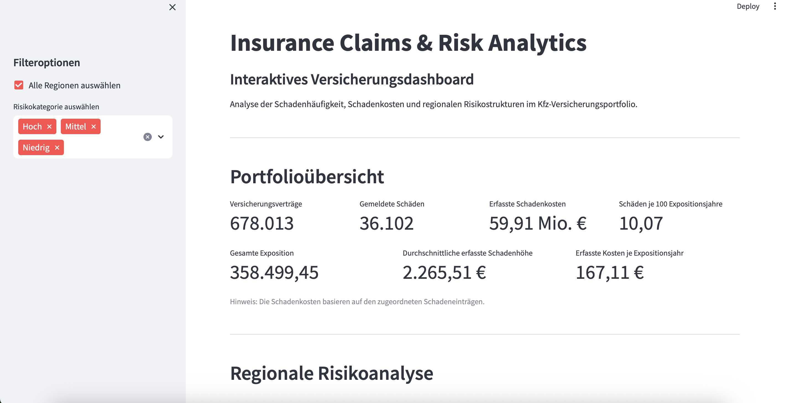
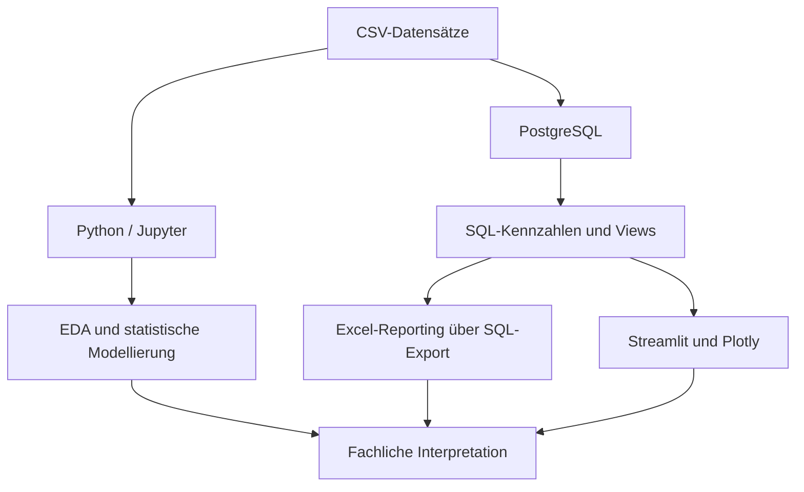
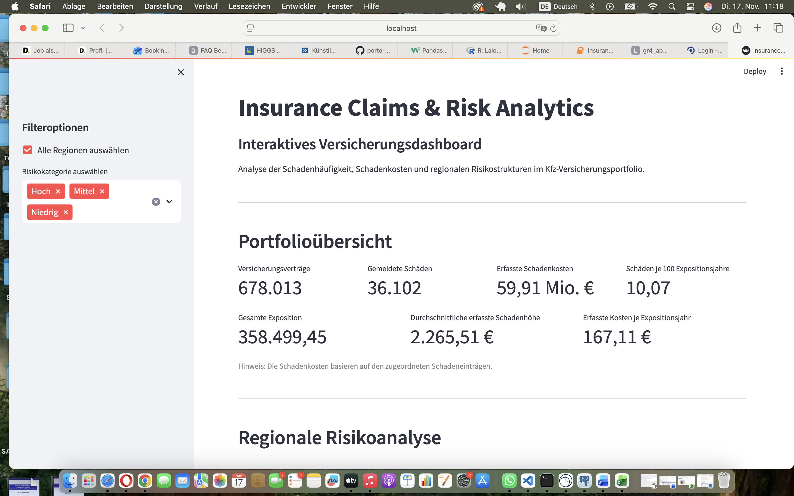
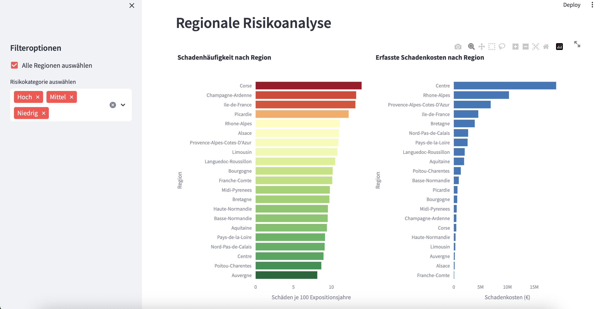
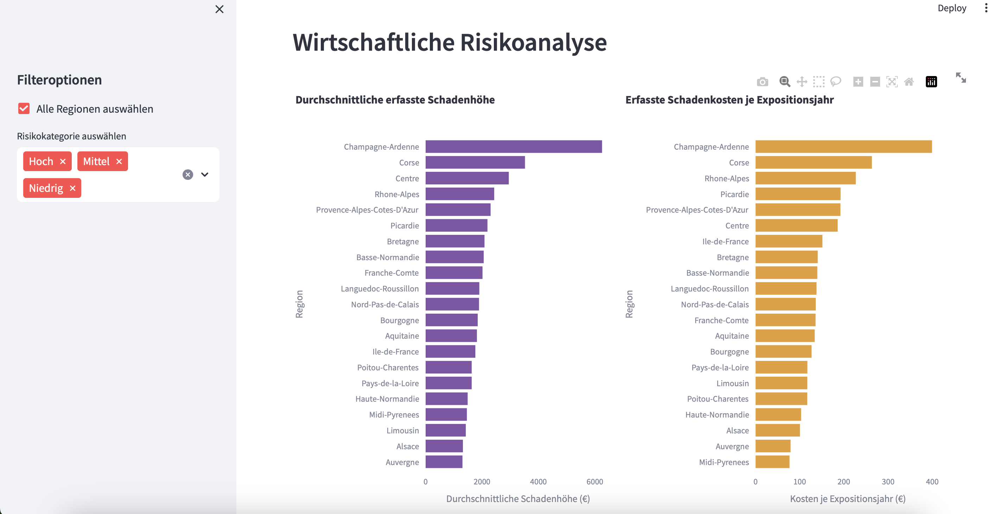
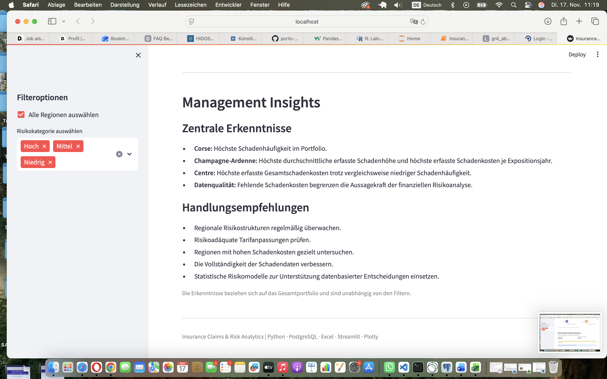

# Insurance Claims & Risk Analytics

**End-to-End-Projekt: von 678.013 Kfz-Versicherungsverträgen zu Risikokennzahlen, statistischem Schadenmodell und Management-Dashboard**

Python · PostgreSQL · SQL · Statistische Modellierung · Excel · Streamlit

---

## Ergebnisse auf einen Blick

| Bereich | Ergebnis |
|---|---|
| **Daten** | 678.013 Verträge, 36.102 gemeldete Schäden, 358.499 Expositionsjahre, 26.639 Schadenbeträge |
| **Datenqualität** | 9.116 Schadenverträge ohne Betrag und 195 Beträge ohne Vertrag transparent ausgewiesen |
| **Schadenhäufigkeit** | **10,07** Schäden je 100 Expositionsjahre; 94,98 % der Verträge ohne Schaden |
| **Großschäden** | Die teuersten 1 % der Schäden verursachen **37,96 %** der Schadenkosten |
| **Junge Fahrer** | 18–25 Jahre: 17,51 statt 9,57 Schäden je 100 Expositionsjahre (**IRR 1,83**; 95-%-KI 1,75–1,91) |
| **Modellierung** | Poisson-GLM mit Expositions-Offset; Überdispersion (2,69) erkannt und korrigiert; Negative-Binomial-Vergleich |
| **Prognose** | 7.197 vorhergesagte vs. 7.241 tatsächliche Schäden im Testdatensatz (**−0,61 %**) |
| **Reporting** | PostgreSQL-Star-Schema mit SQL-Views, Excel-Management-Dashboard, interaktive Streamlit-App |



---

## Projektübersicht

Dieses Projekt untersucht Schadenhäufigkeiten, Schadenhöhen und Risikofaktoren in der französischen Kfz-Haftpflichtversicherung. Ziel ist es, relevante Risikomuster zu identifizieren, die Schadenanzahl statistisch vorherzusagen und versicherungswirtschaftliche Managemententscheidungen durch interaktive Berichte zu unterstützen.

Der Schwerpunkt liegt auf einem nachvollziehbaren End-to-End-Workflow von der Datenaufbereitung über die explorative Analyse und Modellbewertung bis zum datenbankgestützten Reporting.

## Business Understanding

- Welche Fahrer-, Fahrzeug- und Regionalmerkmale stehen mit erhöhten Schadenhäufigkeiten in Zusammenhang?
- Welche Regionen weisen die höchste dokumentierte finanzielle Schadenbelastung auf?
- Wie gut lässt sich die Schadenanzahl unter Berücksichtigung der Exposition prognostizieren?
- Wie können zentrale Versicherungskennzahlen für das Management aufbereitet werden?

## Verwendete Technologien

| Bereich | Technologien und Methoden |
|---|---|
| Data Analytics | Python, Pandas, NumPy, SciPy |
| Visualisierung | Matplotlib, Seaborn, Plotly |
| Statistik | Statsmodels, Scikit-learn, Hypothesentests, Poisson- und Negative-Binomial-Regression |
| Datenbanken | PostgreSQL, pgAdmin, SQL, SQLAlchemy, psycopg2 |
| Business Intelligence | Microsoft Excel (Formeln, bedingte Formatierung, Diagramme), KPI-Reporting, Streamlit |
| Entwicklungsumgebung | Jupyter Notebook |

## Datengrundlage

Verwendet werden die Datensätze `freMTPL2freq` und `freMTPL2sev` zur französischen Kfz-Versicherung.

| Datensatz | Umfang | Inhalt |
|---|---:|---|
| freMTPL2freq | 678.013 Verträge | Vertragsmerkmale, Exposition und Schadenanzahl |
| freMTPL2sev | 26.639 Einträge | Dokumentierte Schadenbeträge |

Die Datensätze werden über die Vertrags-ID verknüpft. Mehrere Schadenbeträge je Vertrag werden vor der SQL-Verknüpfung aggregiert, um eine Vervielfachung von Vertragsdaten zu vermeiden.

## Projektstruktur

```text
Insurance-Claims-Risk-Analytics-BI/
├── data_raw/                    # Lokale CSV-Dateien
├── Notebooks/                   # Jupyter Notebook
├── SQL/
│   ├── 01_create_tables.sql     # Tabellen für die CSV-Quelldaten
│   ├── 02_data_quality.sql      # Datenqualität und ID-Abgleich
│   ├── 03_star_schema.sql       # Sternschema: Dimensionen und Faktentabelle
│   ├── 04_views_analysis.sql    # Views und Analysen mit Window Functions
│   └── 05_export.sql            # CSV-Export für das Excel-Reporting
├── exports/                     # Exportierte CSV-Dateien (lokal erzeugt)
├── Excel & Business Reporting/   # Excel-Management-Dashboard
├── Dashboard/
│   └── app.py                   # Streamlit-Anwendung
├── Screenshots/                 # Dashboard-Ansichten
├── requirements.txt
├── .gitignore
└── README.md
```

## Projektarchitektur



## Methodik

### 1. Datenverständnis und Datenqualität

Untersuchung der Datenstruktur, fehlender Werte, Wertebereiche, Vertrags-IDs und Konsistenz der Versicherungsdaten. Nicht zuordenbare Schadenbeträge werden transparent ausgewiesen.

### 2. Explorative Datenanalyse

Analyse der Verteilung von Schadenanzahl, Exposition und Schadenhöhe sowie Untersuchung von Fahrer-, Fahrzeug- und Vertragsmerkmalen.

### 3. Schaden- und Risikoanalyse

Berechnung expositionsbezogener Kennzahlen, Untersuchung von Großschäden und Vergleich von Risikosegmenten. Ein statistischer Hypothesentest vergleicht die Schadenhäufigkeiten verschiedener Altersgruppen.

### 4. SQL und PostgreSQL

- Import und relationale Verarbeitung der Versicherungsdaten
- Datenqualitätskontrollen und Abgleich der Vertrags-IDs
- Sternschema mit einer Faktentabelle und fünf Dimensionstabellen
- Joins, Aggregationen, CTEs und Window Functions (`RANK() OVER`, `SUM() OVER ()`)
- SQL-Views für Portfolio-KPIs, regionale Risiken und Risikosegmente
- Wiederholbar ausführbare Skripte (`IF NOT EXISTS`, `ON CONFLICT DO NOTHING`) und CSV-Export für Excel

### 5. Statistische Risikomodellierung

Entwicklung einer Poisson-Regression mit Expositionsoffset, Vergleich mit einem Baseline-Modell, Untersuchung der Überdispersion und Vergleich mit einer Negative-Binomial-Regression (GLM mit vorgegebenem Alpha). Bewertung anhand von Testdaten.

### 6. Excel und Business Intelligence

Aufbereitung der SQL-Ergebnisse in einer Excel-Arbeitsmappe mit fünf Blättern (Dashboard, Regionen, Segmente, KPI-Daten, Hinweise): formelbasierte Kennzahlen, Risikokategorisierung, Rangfolgen, Relativitäten je Risikosegment, bedingte Formatierung und Diagramme. Zusätzlich wird eine Hochrechnung der Kosten je Versicherungsjahr ausgewiesen, bei der fehlende Schadenbeträge mit der durchschnittlichen erfassten Schadenhöhe aufgefüllt werden.

### 7. Interaktives Streamlit-Dashboard

Lokale, über SQLAlchemy an PostgreSQL angebundene Anwendung mit globalen Portfolio-KPIs, regionalen Plotly-Diagrammen, Filtern nach Region und Risikokategorie, Datenqualitätshinweisen und Management Insights. Die globalen KPIs bleiben bei regionalen Filtern bewusst unverändert.

## Zentrale Ergebnisse

### Portfolio-Kennzahlen

| Kennzahl | Ergebnis |
|---|---:|
| Versicherungsverträge | 678.013 |
| Gemeldete Schäden | 36.102 |
| Gesamtexposition | 358.499,45 Versicherungsjahre |
| Schäden je 100 Expositionsjahre | 10,07 |
| Zugeordnete dokumentierte Schadenkosten | 59.909.216,50 € |
| Durchschnittliche zugeordnete Schadenhöhe | 2.265,51 € |
| Erfasste Schadenkosten je Expositionsjahr | 167,11 € |

Im ursprünglichen Schadenhöhendatensatz beträgt die durchschnittliche dokumentierte Schadenhöhe 2.278,54 €. Die teuersten 1 % der dokumentierten Schäden verursachen rund 37,96 % der erfassten Gesamtschadenkosten dieses Datensatzes.

### Statistische Hypothesenprüfung

Die Altersgruppe 18–25 Jahre weist rund 17,51 Schäden je 100 Expositionsjahre auf, gegenüber 9,57 in der Altersgruppe 36–45 Jahre. Das geschätzte Inzidenzratenverhältnis (IRR) beträgt 1,83 (95-%-Konfidenzintervall: 1,75–1,91; p < 0,001). Der beobachtete Zusammenhang ist nicht als kausaler Effekt zu interpretieren.

### Modellvergleich

| Modell | MAE | RMSE | Mean Poisson Deviance |
|---|---:|---:|---:|
| Poisson-Regression | **0,098879** | **0,237251** | **0,321711** |
| Negative-Binomial-Regression | 0,099358 | 0,237311 | 0,321722 |

Die Poisson-Regression verbessert die Prognose gegenüber der einfachen Baseline geringfügig (Baseline-MAE: 0,1000; Baseline-Deviance: 0,3314). Trotz festgestellter Überdispersion erzielt das untersuchte Negative-Binomial-GLM keine besseren Testkennzahlen. Daher wird die Poisson-Regression als Referenzmodell bevorzugt. Die individuelle Prognosegenauigkeit bleibt begrenzt.

### Regionale Management Insights

| Region | Beobachtung |
|---|---|
| Corse | Höchste Schadenhäufigkeit (13,99 Schäden je 100 Expositionsjahre) |
| Champagne-Ardenne | Höchste durchschnittliche zugeordnete Schadenhöhe und höchste erfasste Kosten je Expositionsjahr |
| Centre | Höchste zugeordnete Gesamtschadenkosten trotz vergleichsweise niedriger Schadenhäufigkeit |

## Dashboards

Die Excel-Arbeitsmappe bietet eine kompakte Managementübersicht. Die Streamlit-Anwendung ermöglicht zusätzlich die interaktive Exploration der regionalen Schadenhäufigkeiten und Kostenkennzahlen.

### Excel-Management-Dashboard



### Streamlit – Portfolioübersicht


### Streamlit – Regionale Risikoanalyse



### Streamlit – Wirtschaftliche Risikoanalyse



### Streamlit – Management Insights



## Handlungsempfehlungen

- Regionale und demografische Risikosegmente differenziert überwachen.
- Mögliche Tarifanpassungen auf Grundlage zusätzlicher versicherungstechnischer Informationen prüfen.
- Großschäden separat analysieren und deren finanzielle Auswirkungen beobachten.
- Vollständigkeit der Schadenbeträge und Qualität der Vertragszuordnungen verbessern.
- Statistische Modelle regelmäßig validieren und Management-KPIs transparent kommunizieren.

## Einschränkungen

- 26.444 von 26.639 dokumentierten Schadeneinträgen konnten zugeordnet werden. 195 Einträge mit rund 788.714 € blieben ohne Vertragszuordnung.
- Für 9.116 Verträge mit gemeldeten Schäden liegen keine zugeordneten Schadenkosten vor. Die durchschnittliche Schadenhöhe wird daher nur aus zugeordneten Beträgen berechnet. Die erfassten Schadenkosten je Expositionsjahr enthalten für diese Verträge keine Kosten und stellen somit eine Untergrenze der tatsächlichen Schadenbelastung dar.
- Die finanziellen KPIs bilden nur die zugeordneten dokumentierten Kosten ab, nicht zwingend die gesamte Schadenbelastung.
- Ohne Prämieninformationen ist keine tatsächliche Schadenquote (Loss Ratio) berechenbar.
- 1.224 Verträge (0,18 %) haben eine Exposition über einem Jahr (max. 2,01) und 9 Verträge mehr als vier Schäden, teils bei sehr kurzer Exposition. Diese möglichen Erfassungsfehler wurden dokumentiert, aber nicht bereinigt.
- Die regionale Risikokategorisierung basiert auf illustrativen Schwellenwerten der Schadenhäufigkeit und ist keine validierte Tarifierungsgrundlage.
- Beobachtete Zusammenhänge sind nicht kausal; eine externe Modellvalidierung wurde nicht durchgeführt.
- Das Streamlit-Dashboard läuft lokal und ist nicht als öffentliche Webanwendung bereitgestellt.

## Installation und Reproduzierbarkeit

### 1. Python-Umgebung vorbereiten

Voraussetzungen: Python, PostgreSQL und die beiden CSV-Datensätze. Excel wird zum Öffnen der Arbeitsmappe benötigt.

Im Hauptordner des Projekts:

```bash
python -m pip install -r requirements.txt
```

### 2. Notebook ausführen

CSV-Dateien in `data_raw/` bereitstellen und bei Bedarf die Dateipfade im Notebook anpassen.

```bash
jupyter notebook
```

Das Notebook im Ordner `Notebooks/` öffnen und die Zellen der Reihe nach ausführen.

### 3. PostgreSQL vorbereiten

Die Datenbank `insurance_analytics` anlegen und die Skripte im Ordner `SQL/` der Reihe nach ausführen (z. B. in pgAdmin oder mit `psql -d insurance_analytics -f SQL/01_create_tables.sql`):

1. `01_create_tables.sql` – Tabellen anlegen, danach die beiden CSV-Dateien importieren (Importbefehle im Skript)
2. `02_data_quality.sql` – Datenqualität prüfen
3. `03_star_schema.sql` – Sternschema aufbauen
4. `04_views_analysis.sql` – Views und Analysen erstellen
5. `05_export.sql` – CSV-Dateien für Excel nach `exports/` exportieren (mit `psql` aus dem Hauptordner)

Für das Dashboard werden die Views `analytics.v_kpi_summary` und `analytics.v_regional_risk` benötigt.

### 4. Streamlit konfigurieren und starten

Im Hauptordner eine lokale Datei `.streamlit/secrets.toml` mit den eigenen Datenbankverbindungsdaten anlegen:

```toml
[postgres]
host = "localhost"
port = 5432
database = "insurance_analytics"
user = "YOUR_USER"
password = "YOUR_PASSWORD"
```

Die Zugangsdaten sind Platzhalter. Die tatsächliche Secrets-Datei darf nicht veröffentlicht werden.

Aus dem Hauptordner starten:

```bash
streamlit run Dashboard/app.py
```

## Projektziel und Fazit

Das Projekt demonstriert praktische Kompetenzen in Data Analytics, Datenqualität, relationaler Datenverarbeitung, statistischer Modellierung und Business Intelligence. Es verbindet die technische Analyse mit der fachlichen Interpretation versicherungstechnischer Kennzahlen und deren verständlicher Kommunikation für Managemententscheidungen.
